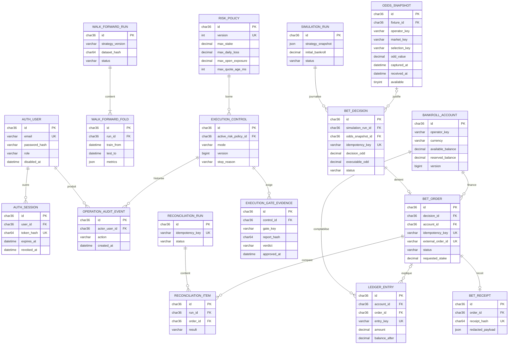

# PLAN — Exécution sécurisée des paris

Date : 2026-10-02 · Décideur : Kevin · Statut : **PROPOSÉ**
Fichiers du chantier : `SUIVI_EXECUTION_PARIS.md` · `BACKLOG_EXECUTION_PARIS.md`

> Ce fichier est **gelé** dès que Kevin le valide. Aucun agent n'y écrit pendant
> l'exécution. Une découverte va au BACKLOG, un avancement au SUIVI. Toute
> modification de périmètre est une décision de Kevin, inscrite au chapitre 7.

## 1. Objectif

Passer d'un système de suggestions à une chaîne auditable qui valide un signal sur des cotes réellement observables, simule en continu, puis peut exécuter sous limites strictes.
Supprimer tout secret du navigateur et rendre impossible une mise réelle sans authentification, idempotence, reçu, réconciliation et autorisation explicite de Kevin.

## 2. Périmètre

### Dans le périmètre

- Remplacer `NEXT_PUBLIC_API_KEY` par un BFF Next.js, une session utilisateur `HttpOnly` et des rôles backend ; la clé technique reste uniquement côté serveur.
- Protéger les mutations administratives et financières par authentification, autorisation par rôle, contrôle d'origine et journal d'audit.
- Rendre obligatoire une cote datée, disponible et attribuée à un opérateur/bookmaker ; supprimer tout fallback de cote fictive du live, du backtest et de la simulation.
- Introduire une validation walk-forward sans fuite temporelle, avec versions de stratégie, fenêtres figées, couverture des cotes et résultats reproductibles.
- Exécuter une simulation continue avec bankroll virtuelle, latence, slippage, refus, résolution et comparaison entre cote décidée et cote exécutable.
- Construire un noyau financier transactionnel : décision, ordre, tentative, reçu, ledger append-only, budget réservé, risque, rapprochement et traitement des réponses ambiguës.
- Fournir un kill switch manuel persistant, fail-closed, et des arrêts automatiques sur limites, incohérences, indisponibilité ou défaut de réconciliation.
- Fournir un port opérateur, un adaptateur papier, un adaptateur sandbox et, après sélection/autorisation, un adaptateur pour l'opérateur approuvé.
- Déployer par paliers `DISABLED` → `SIMULATION` → `SANDBOX` → `LIVE_CANARY`, sans promotion automatique et avec gates GO/NO-GO documentés.
- Ajouter les migrations MySQL, tests unitaires, intégration et e2e nécessaires, ainsi qu'un écran d'exploitation minimal pour surveiller et arrêter le système.

### Hors périmètre

- Optimisation ou réentraînement du modèle de prédiction — chantier distinct après obtention d'une mesure walk-forward fiable.
- Arbitrage, combinés, cash-out, multi-opérateur actif-actif et routage vers la meilleure cote — à envisager dans `BACKLOG_EXECUTION_PARIS.md` après un premier opérateur stable.
- Dépôts, retraits, gestion de moyens de paiement ou conservation d'argent utilisateur — le chantier ne gère qu'une bankroll opérateur préfinancée et bornée.
- Application mobile, refonte visuelle générale et notifications marketing — sans rapport avec la sécurité d'exécution.
- Migration rétroactive des anciens `smart_coupons` vers le ledger financier — leur provenance et leurs cotes ne satisfont pas les nouveaux invariants.
- Reconstruction d'une cote manquante à partir du résultat, d'une moyenne, d'une configuration ou d'une source postérieure — interdite, pas reportée.
- Multi-devise et conversion FX — une seule devise explicite par compte de bankroll dans ce chantier.
- Augmentation automatique des plafonds ou passage automatique en argent réel — toute hausse et toute promotion restent une décision manuelle de Kevin.
- Avis juridique, homologation réglementaire et négociation contractuelle avec un opérateur — prérequis externes au GO réel, jamais simulés par du code.
- Mise en place d'un coffre-fort de secrets ou d'une plateforme CI/CD complète si l'infrastructure n'en dispose pas — chantier d'exploitation séparé ; ce plan exige seulement que les secrets restent serveur et injectés à l'exécution.
- Conservation illimitée de payloads bruts contenant des données sensibles — seuls les champs nécessaires, les hashes et une version expurgée du reçu sont conservés.

## 3. Contrat d'interface

### 3.1 Types partagés et invariants

Les types sont définis avant toute parallélisation dans `backend/src/execution/execution.types.ts`, puis reflétés sans `any` dans `front/lib/types/execution.ts` :

```ts
type ExecutionMode = 'DISABLED' | 'SIMULATION' | 'SANDBOX' | 'LIVE_CANARY';
type UserRole = 'VIEWER' | 'OPERATOR' | 'ADMIN';
type DecisionStatus = 'REJECTED' | 'ELIGIBLE' | 'ORDER_RESERVED' | 'COMPLETED';
type OrderStatus =
  | 'RESERVED' | 'SUBMITTING' | 'ACCEPTED' | 'REJECTED'
  | 'UNKNOWN' | 'SETTLED' | 'VOIDED' | 'RECONCILIATION_REQUIRED';
type RejectionCode =
  | 'NO_EXECUTABLE_ODD' | 'STALE_ODD' | 'SUSPENDED_MARKET'
  | 'ODD_MOVED' | 'LIMIT_EXCEEDED' | 'CONTROL_DISABLED'
  | 'RISK_CHECK_FAILED' | 'OPERATOR_UNAVAILABLE';
```

- Une cote exploitable possède `oddsSnapshotId`, `operatorKey`, `marketKey`, `selectionKey`, `oddValue`, `capturedAt`, `receivedAt`, `available=true` et `ageMs <= maxQuoteAgeMs`.
- `capturedAt` et `receivedAt` doivent être inférieurs ou égaux à `decisionAt`. Le backtest ne lit aucune donnée métier dont l'horodatage est postérieur à la décision, sauf la cote d'exécution recherchée explicitement à `decisionAt + executionLatencyMs`.
- Une décision sans cote admissible est persistée avec `REJECTED/NO_EXECUTABLE_ODD`; aucune cote de configuration ne remplace la donnée absente.
- Toute somme est un `decimal`, jamais un `float`; toute écriture financière porte `currency`, `idempotencyKey` et un horodatage UTC.
- Une réponse opérateur ambiguë produit `UNKNOWN`, bloque tout nouvel essai de placement et ne sort de cet état que par réconciliation.
- Les statuts SQL restent des `varchar` contrôlés par le domaine pour permettre leur évolution sans `ALTER ENUM`.
- Les réponses publiques n'exposent jamais `passwordHash`, `sessionTokenHash`, clé opérateur, clé backend ni payload brut non expurgé.

### 3.2 Authentification et BFF

| Méthode | Route | Rôle | Entrée | Sortie / effet |
|---|---|---|---|---|
| `POST` | backend `/auth/login` | clé BFF, sans session | `{ email, password }` | `{ sessionToken, expiresAt, user }`; le token est consommé par le BFF et n'est jamais renvoyé au JavaScript navigateur. |
| `POST` | backend `/auth/logout` | session active | aucune | révocation idempotente, `204`. |
| `GET` | backend `/auth/me` | session active | aucune | `{ id, email, role }`. |
| `POST` | BFF `/api/auth/login` | public même origine | `{ email, password }` | pose un cookie `HttpOnly`, `Secure`, `SameSite=Strict`, renvoie uniquement `user`. |
| `POST` | BFF `/api/auth/logout` | utilisateur | en-tête CSRF/origine valide | révoque et supprime le cookie. |
| `ANY` | BFF `/api/backend/[...path]` | utilisateur | chemin et méthode dans une allowlist | proxy serveur vers backend avec clé BFF et session ; aucun proxy ouvert vers une URL arbitraire. |

- `@Public()` reste réservé aux endpoints de santé déjà publics. `@SessionPublic()` ne contourne que la session et sert au login ; la clé serveur BFF reste requise.
- `@Roles('ADMIN' | 'OPERATOR')` protège les mutations. `VIEWER` est lecture seule. Les refus `401/403` sont testés à chaque frontière.
- Les requêtes mutantes du BFF vérifient `Origin`/`Host` et un jeton CSRF lié à la session. Les erreurs backend sont normalisées sans fuite du corps interne.
- Variables frontend : `BACKEND_API_BASE_URL`, `BACKEND_API_KEY`, `SESSION_COOKIE_NAME`, `SESSION_COOKIE_SECURE`; aucune variable `NEXT_PUBLIC_*` ne contient un secret.

### 3.3 Cotes, validation et simulation

```ts
interface ExecutableQuote {
  oddsSnapshotId: string;
  operatorKey: string;
  marketKey: string;
  selectionKey: string;
  oddValue: number;
  capturedAt: string;
  receivedAt: string;
  ageMs: number;
}

interface OperatorPort {
  getExecutableQuote(input: QuoteRequest): Promise<ExecutableQuote | null>;
  placeOrder(input: PlaceOrderRequest): Promise<PlaceOrderResult>;
  getOrderByIdempotencyKey(key: string): Promise<OperatorOrder | null>;
  getOrderByExternalId(id: string): Promise<OperatorOrder | null>;
  getBalance(): Promise<OperatorBalance>;
}
```

| Méthode | Route | Rôle | Contrat |
|---|---|---|---|
| `POST` | `/audit/walk-forward` | `ADMIN` | `RunWalkForwardDto { strategyVersion, strategy, trainWindowDays, validationWindowDays, testWindowDays, stepDays, from, to, bookmakerKey, maxQuoteAgeMs, executionLatencyMs }` → `202 { runId }`. |
| `GET` | `/audit/walk-forward/:id` | `VIEWER+` | run, folds ordonnés, couverture de cotes, ROI net, drawdown, intervalle de confiance, hash des données et motifs de rejet. |
| `POST` | `/simulation/runs` | `ADMIN` | snapshot de stratégie, bankroll et politique de cote → run `RUNNING`; rejoué avec la même clé, retourne le même run. |
| `POST` | `/simulation/runs/:id/stop` | `ADMIN` | arrêt idempotent ; aucune nouvelle décision après `stoppedAt`. |
| `GET` | `/simulation/runs/:id/decisions` | `VIEWER+` | pagination par curseur, filtres statut/marché/date et comparaison `decisionOdd/executableOdd/slippage/outcome/profit`. |
| `GET` | `/simulation/runs/:id/summary` | `VIEWER+` | bankroll, exposition, P&L, hit rate, ROI, drawdown, latence, slippage, rejets et couverture des cotes. |

Le walk-forward fige chaque fold : la stratégie est ajustée uniquement sur la fenêtre d'entraînement, sélectionnée sur validation, puis mesurée une seule fois sur test. Un fold incomplet ou privé d'une couverture minimale de cotes est `INELIGIBLE`, jamais complété par interpolation.

### 3.4 Contrôle, risque, ordres et réconciliation

| Méthode | Route | Rôle | Entrée / sortie |
|---|---|---|---|
| `GET` | `/execution/control` | `VIEWER+` | mode, version, motif, acteur, limites actives, santé de la réconciliation. |
| `PUT` | `/execution/control/stop` | `ADMIN` | `{ reason, expectedVersion }` → passe immédiatement à `DISABLED`; idempotent si déjà arrêté. |
| `PUT` | `/execution/control/mode` | `ADMIN` | `{ targetMode, reason, expectedVersion, gateEvidenceIds }`; refuse toute transition non adjacente ou sans gate. |
| `GET` | `/execution/accounts/:id` | `VIEWER+` | solde disponible, réservé, exposition et limites, tous dans une devise unique. |
| `GET` | `/execution/orders` | `VIEWER+` | ordres filtrés et paginés, reçu expurgé et statut de rapprochement. |
| `POST` | `/execution/reconciliations` | `OPERATOR+` | déclenche un run idempotent pour une plage temporelle ; `202 { runId }`. |
| `GET` | `/execution/reconciliations/:id` | `VIEWER+` | écarts d'ordres, de reçus et de solde ; tout écart critique maintient l'exécution arrêtée. |

`PlaceOrderRequest` contient obligatoirement `decisionId`, `idempotencyKey`, `operatorKey`, `marketKey`, `selectionKey`, `requestedOdd`, `minimumOdd`, `stake`, `currency` et `quoteCapturedAt`. `PlaceOrderResult` est une union discriminée `ACCEPTED | REJECTED | UNKNOWN`; `ACCEPTED` exige `externalOrderId`, `acceptedOdd`, `acceptedStake`, `acceptedAt` et `receiptHash`.

La clé d'idempotence est déterministe sur `mode + operatorKey + fixtureId + marketKey + selectionKey + strategyVersion + decisionBucket`; elle est unique dans la base et réutilisée auprès de l'opérateur. Un timeout ne génère jamais une nouvelle clé.

### 3.5 Modèle de données

#### Requêtes chaudes qui pilotent le schéma

1. Résoudre une session par hash, vérifier expiration/révocation et charger le rôle en une requête.
2. Trouver la dernière cote admissible d'une fixture/marché/sélection/opérateur avant un instant donné.
3. Lister les décisions d'un run par date/statut et agréger P&L, couverture, latence et slippage.
4. Verrouiller le contrôle global et le compte de bankroll avant de réserver une mise.
5. Retrouver un ordre par clé d'idempotence ou identifiant opérateur sans doublon.
6. Lister les ordres `UNKNOWN`/non rapprochés et les écritures ledger d'un compte dans l'ordre.
7. Calculer exposition et perte quotidienne à partir du ledger sans requête dans une boucle.
8. Auditer toute transition de mode, modification de limite et action administrative par date/acteur.

#### Entités et contraintes

- `auth_users` : email normalisé unique, hash Argon2id, rôle, `disabled_at`; pas de suppression physique pendant le chantier.
- `auth_sessions` : token hash unique, FK utilisateur `RESTRICT`, expiration/révocation ; purge physique autorisée après rétention.
- `odds_snapshots` enrichi : clés stables opérateur/marché/sélection, `received_at`, `available`, identifiant de ligne fournisseur et index `(fixture_id, operator_key, market_key, selection_key, captured_at)`.
- `walk_forward_runs` et `walk_forward_folds` : configuration/hashes, fenêtres, métriques, couverture et statut ; FK `RESTRICT`.
- `simulation_runs` : stratégie et politique de risque figées, bankroll initiale, statut et timestamps.
- `bet_decisions` : une ligne pour chaque signal accepté ou rejeté ; unicité métier de la clé d'idempotence ; copie immuable de la cote pour survivre à la rétention des snapshots.
- `execution_controls` : une ligne globale versionnée ; mode par défaut `DISABLED`, `RESTRICT` implicite car aucune suppression n'est autorisée.
- `risk_policies` : versions immuables des plafonds par pari/jour/perte/exposition, âge maximal de cote et devise ; une seule version active référencée par le contrôle.
- `execution_gate_evidence` : preuves immuables des gates, avec type, période, métriques, hash de rapport, verdict et approbateur ; aucune preuve auto-déclarée par l'adaptateur opérateur.
- `bankroll_accounts` : un compte par `(mode, operator_key, currency)`, solde disponible/réservé mis à jour transactionnellement et version optimiste.
- `bet_orders` : un ordre par décision et clé d'idempotence, `external_order_id` unique lorsqu'il existe, statut `UNKNOWN` sur ambiguïté.
- `bet_receipts` : reçu expurgé immuable 1-1 avec l'ordre, hash unique, FK `RESTRICT`.
- `bankroll_ledger_entries` : journal append-only, montant signé `decimal`, solde après écriture, type `RESERVE/RELEASE/SETTLE/ADJUSTMENT`, clé d'écriture unique ; aucune mise à jour/suppression applicative.
- `reconciliation_runs` et `reconciliation_items` : chaque comparaison conserve résultat, écart et preuve ; FKs `RESTRICT`.
- `operation_audit_events` : acteur nullable (`SET NULL` si compte désactivé), action, cible, trace et métadonnées expurgées ; pas de suppression pendant la rétention réglementaire définie au GO.



La migration n'utilise pas de DDL transactionnel implicite : MySQL peut laisser un schéma partiellement appliqué. Chaque migration a un `down()` symétrique, des contraintes/index nommés et est vérifiée sur une base jetable avant tout environnement conservé.

### 3.6 Éléments réutilisables et duplication à éviter

- Réutiliser `OddsSnapshot`, son ingestion et ses index comme source de cote ; enrichir ce modèle dans le lot qui le touche au lieu de créer une seconde table de cotes.
- Réutiliser `BacktestEngineService`, `BacktestRun`, `BetResult` et `KpisCalculator`; extraire le sélecteur de cote observable seulement entre live/backtest/simulation, tous touchés par les lots 3 à 5.
- Réutiliser `SmartRulesConfigService` et `evaluateRules`; séparer le signal (`RuleMatch`) de la cote exécutable afin qu'une règle ne fabrique plus de prix.
- Réutiliser les middlewares de trace/logging et `AppRuntimeState` pour les réglages non financiers. Ne pas réutiliser son JSON générique pour le kill switch financier : la transition atomique/versionnée exige `execution_controls` typé.
- Réutiliser le `ApiKeyGuard` comme authentification serveur-à-serveur, mais ajouter une session utilisateur distincte ; ne pas transformer la clé technique en identité utilisateur.
- Centraliser l'idempotence, les transitions d'ordre, le calcul de slippage et les montants dans le module `execution`; aucun contrôleur/adaptateur ne recalcule ces règles.
- Une abstraction repérée en dehors des fichiers d'un lot va au BACKLOG et n'est pas extraite pendant ce chantier.

## 4. Lots

### Lot 1 — Authentification backend et autorisation par rôle

- **Dépendances** : aucune. Le mode d'exécution reste `DISABLED`.
- **Routage** : `backend-dev` implémente ; `tester` couvre auth, révocation et autorisations ; `reviewer` valide sécurité et absence de fuite.
- **Fichiers** :
  - `backend/package.json`
  - `backend/package-lock.json`
  - `backend/.env.example`
  - `backend/src/app.module.ts`
  - `backend/src/config/env.validation.ts`
  - `backend/src/database/entities/index.ts`
  - `backend/src/database/entities/auth-user.entity.ts`
  - `backend/src/database/entities/auth-session.entity.ts`
  - `backend/src/database/entities/operation-audit-event.entity.ts`
  - `backend/src/database/migrations/20261002090000-create-authentication.ts`
  - `backend/src/auth/auth.module.ts`
  - `backend/src/auth/auth.controller.ts`
  - `backend/src/auth/auth.service.ts`
  - `backend/src/auth/auth.service.spec.ts`
  - `backend/src/auth/auth.controller.spec.ts`
  - `backend/src/auth/dto/login.dto.ts`
  - `backend/src/auth/auth.types.ts`
  - `backend/src/common/decorators/session-public.decorator.ts`
  - `backend/src/common/decorators/roles.decorator.ts`
  - `backend/src/common/decorators/current-user.decorator.ts`
  - `backend/src/common/guards/api-key.guard.ts`
  - `backend/src/common/guards/api-key.guard.spec.ts`
  - `backend/src/common/guards/session.guard.ts`
  - `backend/src/common/guards/session.guard.spec.ts`
  - `backend/src/common/guards/roles.guard.ts`
  - `backend/src/common/guards/roles.guard.spec.ts`
  - `backend/src/scripts/create-admin.ts`
- **Contenu** : ajouter Argon2id, stocker seulement le hash du token de session, rotation à la connexion, expiration/révocation, protection anti-bruteforce bornée, rôles `VIEWER/OPERATOR/ADMIN`, audit des connexions et mutations, et CLI explicite de création du premier admin. La clé API existante devient exclusivement serveur-à-serveur. Les health checks `@Public()` restent les seules routes sans clé ni session.
- **Tests obligatoires** : mot de passe invalide, compte désactivé, session expirée/révoquée, rejeu de logout, clé BFF invalide, absence de session, rôle insuffisant, deux connexions concurrentes, champs secrets absents des réponses et logs.
- **Critère de sortie** : `Set-Location backend; npm test -- --runInBand auth common/guards; if ($LASTEXITCODE -ne 0) { exit $LASTEXITCODE }; npm run build`
- **Hors périmètre de ce lot** : BFF Next.js, SSO/OAuth, récupération de mot de passe, gestion d'utilisateurs par interface et tout changement de logique de pari.

### Lot 2 — BFF Next.js et suppression du secret navigateur

- **Dépendances** : lot 1 terminé et contrat `/auth/*` gelé.
- **Routage** : `frontend-dev` implémente ; `tester` ajoute les tests de routes et de frontières ; `reviewer` inspecte bundle, proxy et protections CSRF.
- **Fichiers** :
  - `front/package.json`
  - `front/pnpm-lock.yaml`
  - `front/.env.local.example`
  - `front/tsconfig.json`
  - `front/vitest.config.ts`
  - `front/test/setup.ts`
  - `front/middleware.ts`
  - `front/app/layout.tsx`
  - `front/app/login/page.tsx`
  - `front/app/api/auth/login/route.ts`
  - `front/app/api/auth/logout/route.ts`
  - `front/app/api/auth/me/route.ts`
  - `front/app/api/backend/[...path]/route.ts`
  - `front/lib/api/client.ts`
  - `front/lib/server/backend-client.ts`
  - `front/lib/server/bff-allowlist.ts`
  - `front/lib/server/csrf.ts`
  - `front/lib/server/session-cookie.ts`
  - `front/lib/types/auth.ts`
  - `front/app/api/auth/login/route.test.ts`
  - `front/app/api/auth/logout/route.test.ts`
  - `front/app/api/backend/[...path]/route.test.ts`
- **Contenu** : faire passer tous les appels navigateur par une route même origine ; injecter `BACKEND_API_KEY` et le token de session uniquement côté serveur ; limiter chemins/méthodes proxyfiables ; normaliser erreurs et timeouts ; rediriger les pages protégées ; supprimer `NEXT_PUBLIC_API_KEY` et l'URL backend publique. Ajouter un test de bundle recherchant les noms/valeurs sentinelles de secrets.
- **Tests obligatoires** : login pose les attributs de cookie, logout idempotent, mutation cross-origin refusée, chemin non allowlisté refusé, réponse backend invalide/401/403, session absente, en-têtes sensibles jamais reflétés et build sans valeur secrète sentinelle.
- **Critère de sortie** : `Set-Location front; npm run test; if ($LASTEXITCODE -ne 0) { exit $LASTEXITCODE }; npx tsc --noEmit --incremental false; if ($LASTEXITCODE -ne 0) { exit $LASTEXITCODE }; npm run build; if ($LASTEXITCODE -ne 0) { exit $LASTEXITCODE }; if (Get-ChildItem -Recurse -File .next | Select-String -SimpleMatch 'NEXT_PUBLIC_API_KEY','sentinel-backend-secret') { exit 1 }`
- **Hors périmètre de ce lot** : nouveau design global, SSO, cache BFF, proxy générique sans allowlist et modification du moteur de recommandations.

### Gate G1 — Frontière de sécurité

GO vers les lots métier uniquement si : `NEXT_PUBLIC_API_KEY` n'existe plus dans le code/configuration frontend, le bundle ne contient pas de secret sentinelle, les mutations exigent session+rôle+CSRF, le backend refuse l'accès direct sans clé serveur et les tests `401/403` sont verts. Sinon : NO-GO et correction dans le lot 1 ou 2, jamais reportée au lot 3.

### Lot 3 — Cote observable et suppression des fallbacks fictifs

- **Dépendances** : Gate G1 verte.
- **Routage** : `backend-dev` implémente le contrat de cote ; `tester` couvre temporalité et absence de donnée ; `reviewer` cherche toute fabrication de cote restante.
- **Fichiers** :
  - `backend/src/database/entities/odds-snapshot.entity.ts`
  - `backend/src/database/entities/index.ts`
  - `backend/src/database/migrations/20261002100000-enrich-executable-odds.ts`
  - `backend/src/odds/odds.types.ts`
  - `backend/src/odds/executable-quote.service.ts`
  - `backend/src/odds/executable-quote.service.spec.ts`
  - `backend/src/odds/apifootball-odds.mapper.ts`
  - `backend/src/odds/apifootball-odds.mapper.spec.ts`
  - `backend/src/odds/odds-ingestion.service.ts`
  - `backend/src/odds/odds-ingestion.service.spec.ts`
  - `backend/src/odds/odds.module.ts`
  - `backend/src/backtest/backtest.types.ts`
  - `backend/src/backtest/baseline.strategy.ts`
  - `backend/src/backtest/backtest-engine.service.ts`
  - `backend/src/backtest/backtest-engine.service.spec.ts`
  - `backend/src/recommendations/rules/rules-evaluator.ts`
  - `backend/src/recommendations/rules/rules-evaluator.spec.ts`
  - `backend/src/recommendations/smart-suggestions.service.ts`
  - `backend/src/recommendations/smart-suggestions.service.spec.ts`
- **Contenu** : enrichir l'ingestion avec les clés fournisseur, disponibilité et temps de réception ; extraire un unique `ExecutableQuoteService`; sélectionner la dernière cote admissible sans donnée future ; séparer règle de signal et prix ; retirer `STRATEGY_DEFAULT`, `liveOdd ?? configOdd` et tout fallback analogue. Les lignes historiques non enrichissables restent présentes mais inéligibles.
- **Tests obligatoires** : cote exacte à T, cote reçue après T exclue, marché suspendu, cote trop vieille, bookmaker/marché/sélection distincts, aucune cote, latence sans snapshot, deux snapshots concurrents, mapping fournisseur incomplet et test source recherchant les anciens fallback literals.
- **Critère de sortie** : `Set-Location backend; npm test -- --runInBand odds backtest recommendations/rules recommendations/smart-suggestions.service.spec.ts; if ($LASTEXITCODE -ne 0) { exit $LASTEXITCODE }; if (rg -n "STRATEGY_DEFAULT|liveOdd\s*\?\?|sourced\?\.odd\s*\?\?" src) { exit 1 }; npm run build`
- **Hors périmètre de ce lot** : calcul de performance walk-forward, ajout d'un second fournisseur de cotes, nettoyage des anciennes lignes et refactor de modules non touchés.

### Lot 4 — Validation walk-forward reproductible

- **Dépendances** : lot 3 ; historique de cotes suffisant. Si la couverture est insuffisante, le lot livre le moteur mais Gate G2 reste NO-GO.
- **Routage** : `backend-dev` implémente moteur et persistance ; `tester` construit les tests anti-look-ahead et de reproductibilité ; `reviewer` valide les frontières temporelles.
- **Fichiers** :
  - `backend/src/database/entities/index.ts`
  - `backend/src/database/entities/walk-forward-run.entity.ts`
  - `backend/src/database/entities/walk-forward-fold.entity.ts`
  - `backend/src/database/migrations/20261002110000-create-walk-forward-validation.ts`
  - `backend/src/backtest/backtest.types.ts`
  - `backend/src/backtest/backtest-engine.service.ts`
  - `backend/src/backtest/kpis-calculator.ts`
  - `backend/src/backtest/kpis-calculator.spec.ts`
  - `backend/src/backtest/walk-forward.service.ts`
  - `backend/src/backtest/walk-forward.service.spec.ts`
  - `backend/src/backtest/backtest.module.ts`
  - `backend/src/audit/dto/run-walk-forward.dto.ts`
  - `backend/src/audit/audit.controller.ts`
  - `backend/src/audit/audit.controller.spec.ts`
  - `backend/src/audit/audit.module.ts`
- **Contenu** : générer des folds chronologiques non chevauchants sur leur fenêtre de test ; figer stratégie/version/config/hashes avant mesure ; utiliser uniquement les données disponibles à chaque instant ; comptabiliser explicitement inéligibles et absences de cote ; calculer ROI net, yield, drawdown, slippage, couverture et intervalle de confiance. Un même input produit le même hash et les mêmes sorties.
- **Tests obligatoires** : frontière exacte des fenêtres, événement/cote futur ignoré, fold incomplet, couverture insuffisante, stratégie modifiée après lancement sans effet, rejouabilité bit-à-bit des champs déterministes, valeurs limites de bankroll et absence de requête N+1 par fixture.
- **Critère de sortie** : `Set-Location backend; npm test -- --runInBand walk-forward backtest audit; if ($LASTEXITCODE -ne 0) { exit $LASTEXITCODE }; npm run lint:check; if ($LASTEXITCODE -ne 0) { exit $LASTEXITCODE }; npm run build`
- **Hors périmètre de ce lot** : optimisation hyperparamétrique automatique, choix du modèle gagnant après lecture du test, génération de nouvelles features et collecte de données manquantes.

### Gate G2 — Signal admissible hors échantillon

Les seuils sont saisis et gelés dans la preuve avant le premier run final. Valeurs initiales proposées : au moins 3 folds de test disjoints, 300 paris résolus, couverture de cote exécutable ≥ 95 %, borne basse de l'intervalle de confiance 95 % du ROI net strictement positive, drawdown maximal ≤ 10 %, aucune fuite temporelle détectée et hash reproductible. Kevin peut réviser ces seuils avant le run final via le chapitre 7 ; jamais après lecture des résultats. Échec d'un seuil = NO-GO simulation financière, sans retoucher le test pour faire passer le signal.

### Lot 5 — Simulation continue et journal de décision

- **Dépendances** : moteur de cote du lot 3 ; Gate G2 verte pour qualifier la simulation comme candidate, mais le mode simulation peut être utilisé plus tôt pour collecter des preuves.
- **Routage** : `backend-dev` implémente journal/scheduler ; `tester` couvre rejeu, concurrence et résolution ; `reviewer` vérifie qu'aucune branche ne contacte un opérateur réel.
- **Fichiers** :
  - `backend/src/app.module.ts`
  - `backend/src/database/entities/index.ts`
  - `backend/src/database/entities/simulation-run.entity.ts`
  - `backend/src/database/entities/bet-decision.entity.ts`
  - `backend/src/database/migrations/20261002120000-create-continuous-simulation.ts`
  - `backend/src/execution/execution.types.ts`
  - `backend/src/simulation/simulation.module.ts`
  - `backend/src/simulation/simulation.controller.ts`
  - `backend/src/simulation/simulation.controller.spec.ts`
  - `backend/src/simulation/simulation.service.ts`
  - `backend/src/simulation/simulation.service.spec.ts`
  - `backend/src/simulation/simulation.scheduler.ts`
  - `backend/src/simulation/simulation.scheduler.spec.ts`
  - `backend/src/simulation/dto/start-simulation.dto.ts`
  - `backend/src/simulation/dto/list-decisions-query.dto.ts`
  - `backend/src/recommendations/smart-suggestions.service.ts`
  - `backend/src/recommendations/smart-suggestions.service.spec.ts`
  - `backend/src/recommendations/rules/outcome-resolver.ts`
  - `backend/src/recommendations/rules/outcome-resolver.spec.ts`
  - `backend/src/odds/executable-quote.service.ts`
- **Contenu** : créer un run long-lived avec snapshots de stratégie/risque ; journaliser chaque signal, y compris les rejets ; calculer clé d'idempotence, bankroll virtuelle, mise proposée, cote à décision, cote à latence simulée, slippage, résultat et P&L. Le scheduler est idempotent : deux ticks/concurrents produisent une seule décision. Le mode ne possède aucune dépendance vers un adaptateur réseau de placement.
- **Tests obligatoires** : double tick simultané, redémarrage après crash, décision sans cote, cote déplacée sous minimum, ordre virtuel accepté/refusé, résultat `VOID/NO_RESULT`, limite de bankroll, arrêt d'un run et agrégats identiques au journal.
- **Critère de sortie** : `Set-Location backend; npm test -- --runInBand simulation recommendations/smart-suggestions.service.spec.ts recommendations/rules/outcome-resolver.spec.ts; if ($LASTEXITCODE -ne 0) { exit $LASTEXITCODE }; npm run build`
- **Hors périmètre de ce lot** : argent réel, appel sandbox, UI complète, modification du signal et migration des `smart_coupons` existants.

### Gate G3 — Simulation continue probante

GO vers sandbox seulement après au moins 30 jours calendaires et 500 décisions résolues (prolonger tant que les deux ne sont pas atteints), disponibilité du journal ≥ 99 %, zéro doublon, zéro bankroll négative, 100 % des décisions reliées à une cote observable ou à un rejet explicite, ROI net et drawdown conformes aux seuils gelés de G2 après latence/slippage, et aucun écart entre agrégats et ledger virtuel. Une panne ou un changement de stratégie remet la fenêtre probante à zéro pour la version concernée.

### Lot 6 — Kill switch, politique de risque et ledger transactionnel

- **Dépendances** : lot 5 ; le contrôle initial et la migration doivent laisser le mode `DISABLED` même si les variables sont mal configurées.
- **Routage** : `backend-dev` implémente transactions et contrôles ; `tester` exécute tests unitaires et intégration MySQL de concurrence ; `reviewer` bloque toute fail-open, mutation du ledger ou calcul monétaire flottant.
- **Fichiers** :
  - `backend/package.json`
  - `backend/package-lock.json`
  - `backend/jest.integration.json`
  - `backend/.env.example`
  - `backend/src/app.module.ts`
  - `backend/src/config/env.validation.ts`
  - `backend/src/database/entities/index.ts`
  - `backend/src/database/entities/execution-control.entity.ts`
  - `backend/src/database/entities/risk-policy.entity.ts`
  - `backend/src/database/entities/execution-gate-evidence.entity.ts`
  - `backend/src/database/entities/bankroll-account.entity.ts`
  - `backend/src/database/entities/bankroll-ledger-entry.entity.ts`
  - `backend/src/database/migrations/20261002130000-create-execution-control-ledger.ts`
  - `backend/src/execution/execution.module.ts`
  - `backend/src/execution/execution.controller.ts`
  - `backend/src/execution/execution.controller.spec.ts`
  - `backend/src/execution/execution.types.ts`
  - `backend/src/execution/dto/stop-execution.dto.ts`
  - `backend/src/execution/dto/change-execution-mode.dto.ts`
  - `backend/src/execution/dto/create-risk-policy.dto.ts`
  - `backend/src/execution/execution-control.service.ts`
  - `backend/src/execution/execution-control.service.spec.ts`
  - `backend/src/execution/risk-engine.service.ts`
  - `backend/src/execution/risk-engine.service.spec.ts`
  - `backend/src/execution/ledger.service.ts`
  - `backend/src/execution/ledger.service.spec.ts`
  - `backend/src/execution/gate-policy.service.ts`
  - `backend/src/execution/gate-policy.service.spec.ts`
  - `backend/src/execution/execution.integration.spec.ts`
- **Contenu** : verrouiller `execution_controls` et `bankroll_accounts` en transaction avant réservation ; appliquer plafonds par pari, jour, perte et exposition ; écrire réserve/relâchement/règlement avec clé unique ; interdire update/delete du ledger au niveau service ; utiliser verrou pessimiste et version pour la concurrence. Le kill switch est lu au démarrage, avant réservation et juste avant soumission ; erreur DB/cache/config = arrêt. La variable `REAL_MONEY_INTERLOCK` est un second verrou et vaut `false` par défaut, mais ne suffit jamais à activer.
- **Arrêts automatiques** : contrôle illisible, cote périmée/suspendue, limite atteinte, solde opérateur divergent, ordre `UNKNOWN` trop ancien, reçu absent, réconciliation en retard, taux d'erreur opérateur, horloge hors tolérance ou invariant ledger rompu. Tout arrêt écrit un audit et nécessite une réactivation manuelle versionnée.
- **Tests obligatoires** : 20 réservations concurrentes sur le dernier budget, limites exactement atteintes/dépassées, double écriture même clé, tentative de mise à jour ledger, DB indisponible, contrôle absent, interlock faux, changement de mode concurrent, arrêt pendant réservation et audit expurgé.
- **Critère de sortie** : `Set-Location backend; npm test -- --runInBand execution; if ($LASTEXITCODE -ne 0) { exit $LASTEXITCODE }; npm run test:integration -- --runInBand execution; if ($LASTEXITCODE -ne 0) { exit $LASTEXITCODE }; npm run build`
- **Hors périmètre de ce lot** : appel opérateur, reçu externe, multi-devise, ajustement manuel de ledger sans workflow approuvé et tableau de bord frontend.

### Lot 7 — Pipeline d'ordre, sandbox déterministe et réconciliation

- **Dépendances** : lot 6 et Gate G3 verte. Reste interdit en `LIVE_CANARY`.
- **Routage** : `backend-dev` implémente port/adaptateurs/pipeline ; `tester` couvre contrats, ambiguïtés et réconciliation ; `reviewer` valide idempotence bout-en-bout et redaction.
- **Fichiers** :
  - `backend/src/database/entities/index.ts`
  - `backend/src/database/entities/bet-decision.entity.ts`
  - `backend/src/database/entities/bankroll-account.entity.ts`
  - `backend/src/database/entities/bet-order.entity.ts`
  - `backend/src/database/entities/bet-receipt.entity.ts`
  - `backend/src/database/entities/reconciliation-run.entity.ts`
  - `backend/src/database/entities/reconciliation-item.entity.ts`
  - `backend/src/database/migrations/20261002140000-create-orders-reconciliation.ts`
  - `backend/src/execution/execution.module.ts`
  - `backend/src/execution/execution.controller.ts`
  - `backend/src/execution/execution.controller.spec.ts`
  - `backend/src/execution/execution.types.ts`
  - `backend/src/execution/operator.port.ts`
  - `backend/src/execution/adapters/paper-operator.adapter.ts`
  - `backend/src/execution/adapters/deterministic-sandbox.adapter.ts`
  - `backend/src/execution/adapters/operator-receipt-redactor.ts`
  - `backend/src/execution/adapters/operator-receipt-redactor.spec.ts`
  - `backend/src/execution/order-execution.service.ts`
  - `backend/src/execution/order-execution.service.spec.ts`
  - `backend/src/execution/reconciliation.service.ts`
  - `backend/src/execution/reconciliation.service.spec.ts`
  - `backend/src/execution/reconciliation.scheduler.ts`
  - `backend/src/execution/reconciliation.scheduler.spec.ts`
  - `backend/src/execution/dto/list-orders-query.dto.ts`
  - `backend/src/execution/dto/start-reconciliation.dto.ts`
  - `backend/src/execution/execution.integration.spec.ts`
- **Contenu** : transformer une décision éligible en réservation atomique ; revérifier contrôle/cote/limites juste avant l'appel ; soumettre une seule fois ; persister résultat et reçu ; régler ou relâcher le ledger. L'adaptateur papier reproduit la simulation, la sandbox déterministe force acceptation/refus/timeout/retard. `UNKNOWN` déclenche uniquement une lecture opérateur par la même clé, jamais un nouveau placement. La réconciliation compare ordres, reçus, règlements et solde en lot sans N+1.
- **Tests obligatoires** : acceptation, refus, déplacement de cote, timeout avant/après acceptation, réponse malformée, reçu dupliqué, crash entre appel et persistance, réconciliation par clé, solde divergent, double scheduler, kill switch entre réservation et soumission et aucune donnée secrète dans logs/reçus.
- **Critère de sortie** : `Set-Location backend; npm test -- --runInBand order-execution reconciliation operator-receipt-redactor; if ($LASTEXITCODE -ne 0) { exit $LASTEXITCODE }; npm run test:integration -- --runInBand execution.integration.spec.ts; if ($LASTEXITCODE -ne 0) { exit $LASTEXITCODE }; npm run build`
- **Hors périmètre de ce lot** : protocole d'un opérateur réel, argent réel, retries de placement sur statut ambigu et UI d'exploitation.

### Gate G4 — Intégrité sandbox

GO vers l'intégration d'un opérateur uniquement après au moins 14 jours de sandbox et 1 000 scénarios automatisés : zéro doublon, zéro dépassement de limite, 100 % des acceptations avec reçu, 100 % des timeouts ambigus rapprochés sans resoumission, zéro écart ledger/solde non expliqué au-delà d'un cycle de réconciliation, arrêt manuel effectif avant toute nouvelle soumission et reprise exclusivement manuelle.

### Lot 8 — Adaptateur de l'opérateur approuvé et validation sur sa sandbox officielle

- **Dépendances** : Gate G4 verte ; opérateur nommé par Kevin ; API officielle de placement autorisée pour le compte/juridiction ; documentation et sandbox accessibles ; revue contractuelle externe terminée. Tant qu'un prérequis manque, ce lot reste `BLOQUÉ`, pas remplacé par du scraping ou de l'automatisation navigateur.
- **Routage** : `backend-dev` implémente le mapping dans le port existant ; `tester` exécute les tests contractuels officiels ; `reviewer` valide auth, timeouts, redaction, conditions de rejeu et absence de contournement des CGU.
- **Fichiers** :
  - `backend/package.json`
  - `backend/package-lock.json`
  - `backend/.env.example`
  - `backend/src/config/env.validation.ts`
  - `backend/src/execution/execution.module.ts`
  - `backend/src/execution/execution.types.ts`
  - `backend/src/execution/operator.port.ts`
  - `backend/src/execution/adapters/production-operator.adapter.ts`
  - `backend/src/execution/adapters/production-operator.types.ts`
  - `backend/src/execution/adapters/production-operator.mapper.ts`
  - `backend/src/execution/adapters/production-operator.mapper.spec.ts`
  - `backend/src/execution/adapters/production-operator.contract.spec.ts`
  - `backend/src/execution/__fixtures__/operator-contract.fixture.ts`
  - `backend/src/execution/order-execution.service.ts`
  - `backend/src/execution/reconciliation.service.ts`
- **Contenu** : mapper exactement le schéma officiel vers `OperatorPort`, utiliser l'idempotence native si disponible, sinon rechercher avant tout placement ; borner timeout et horloge ; vérifier cote/mise acceptées ; expurger reçus ; distinguer rejet définitif et ambiguïté ; récupérer ordres et solde pour réconciliation. Les credentials sont injectés à l'exécution et interdits en base/log/fixture. Si l'API ne permet ni idempotence ni recherche fiable après timeout, Gate G5 est automatiquement NO-GO.
- **Tests obligatoires** : fixtures contractuelles versionnées et expurgées, auth expirée, rate limit, maintenance, rejet marché, changement de cote, timeout ambigu, idempotence, pagination d'ordres, devise/arrondis, reçu incomplet et divergence de solde sur sandbox officielle.
- **Critère de sortie** : `Set-Location backend; npm run test:operator-contract -- --runInBand; if ($LASTEXITCODE -ne 0) { exit $LASTEXITCODE }; npm run build`
- **Hors périmètre de ce lot** : opérateur secondaire, scraping d'un site, contournement MFA/CAPTCHA, dépôt/retrait et activation réelle.

### Gate G5 — Opérateur techniquement exécutable

GO vers préparation du canary seulement si l'opérateur autorise explicitement l'intégration, fournit une identité d'ordre ou une recherche fiable par idempotence, retourne une preuve exploitable, expose le solde/les ordres pour rapprochement, passe 100 % des tests contractuels pendant 14 jours et ne laisse aucun `UNKNOWN` au-delà du délai approuvé. Une impossibilité contractuelle ou technique sur un seul de ces points = NO-GO définitif pour cet opérateur.

### Lot 9 — Console d'exploitation et déploiement progressif

- **Dépendances** : lots 1 à 7 ; les vues opérateur s'activent après lot 8. L'écran d'arrêt doit être utilisable dès `SIMULATION`.
- **Routage** : `frontend-dev` implémente la console fonctionnelle ; `tester` couvre permissions et parcours critique ; `reviewer` valide que l'UI ne peut contourner aucune règle backend.
- **Fichiers** :
  - `front/app/layout.tsx`
  - `front/app/simulation/page.tsx`
  - `front/app/execution/page.tsx`
  - `front/app/audit/page.tsx`
  - `front/components/execution/ExecutionControlPanel.tsx`
  - `front/components/execution/ExecutionControlPanel.test.tsx`
  - `front/components/execution/RiskLimitsPanel.tsx`
  - `front/components/execution/OrdersTable.tsx`
  - `front/components/execution/ReconciliationStatus.tsx`
  - `front/components/simulation/SimulationSummary.tsx`
  - `front/components/simulation/DecisionJournalTable.tsx`
  - `front/lib/api/execution.ts`
  - `front/lib/api/simulation.ts`
  - `front/lib/api/audit.ts`
  - `front/lib/types/execution.ts`
  - `front/lib/types/simulation.ts`
  - `front/lib/server/bff-allowlist.ts`
  - `front/app/api/backend/[...path]/route.test.ts`
- **Contenu** : afficher mode, version, politiques, bankroll, exposition, ordres ambigus, dernier rapprochement, décisions et métriques ; rendre l'arrêt immédiat accessible avec confirmation du motif, mais sans confirmation supplémentaire pour exécuter l'arrêt lui-même ; exiger version attendue sur les mutations. L'UI ne possède ni calcul de risque ni transition locale optimiste : elle affiche la réponse persistée du backend.
- **Tests obligatoires** : `VIEWER` lecture seule, `OPERATOR` réconciliation sans changement de mode, `ADMIN` arrêt, double clic idempotent, conflit de version, backend indisponible affiché comme arrêté/inconnu et aucun état visuel trompeur « actif ».
- **Critère de sortie** : `Set-Location front; npm run test; if ($LASTEXITCODE -ne 0) { exit $LASTEXITCODE }; npx tsc --noEmit --incremental false; if ($LASTEXITCODE -ne 0) { exit $LASTEXITCODE }; npm run build`
- **Hors périmètre de ce lot** : redesign, graphiques prédictifs avancés, notifications push, gestion de comptes utilisateurs et modification des règles métier côté navigateur.

### Gate G6 — Autorisation du canary réel

Le premier passage à `LIVE_CANARY` exige simultanément : G1 à G5 vertes ; validation explicite de Kevin enregistrée comme preuve ; backup et restauration testés ; credentials production séparés de la sandbox ; horloge/monitoring/alertes opérationnels ; réconciliation réussie juste avant activation ; `maxStake`, budget total, perte quotidienne et exposition définis à des valeurs non nulles strictement bornées ; arrêt manuel testé en production sans placement ; astreinte identifiée. Le canary commence avec un seul marché, un seul opérateur et le budget approuvé. Toute alerte repasse à `DISABLED`; aucune reprise automatique.

### Séquence de déploiement

1. Déployer schémas et code avec `REAL_MONEY_INTERLOCK=false`, contrôle `DISABLED` et aucun credential opérateur production.
2. Valider G1, collecter les cotes, exécuter le walk-forward puis enregistrer G2.
3. Activer uniquement `SIMULATION`, observer jusqu'à G3 et corriger les défauts dans leur lot d'origine.
4. Déployer noyau financier et sandbox, garder l'interlock réel à `false`, puis enregistrer G4.
5. Après sélection externe, déployer l'adaptateur avec credentials sandbox, obtenir G5 et auditer les reçus.
6. Injecter les credentials production sans changer de mode ; réaliser backup, test d'arrêt et rapprochement à blanc.
7. Kevin enregistre G6 puis active `LIVE_CANARY`; surveiller chaque ordre et réconcilier à fréquence courte.
8. Toute hausse de plafond ou extension de marché/opérateur est un nouveau gate approuvé, jamais une conséquence automatique du succès du canary.

## 5. Définition de terminé du chantier

Le chantier peut porter la mention `CLOS` uniquement lorsque toutes les conditions suivantes sont prouvées dans `SUIVI_EXECUTION_PARIS.md` :

- Lots 1 à 9 terminés, relus par `reviewer`, avec commandes de sortie vertes et aucun finding bloquant ouvert.
- Migrations `up` et `down` validées sur base MySQL jetable, puis `up` validé sur une copie représentative ; aucun `synchronize: true`.
- G1 à G5 vertes et preuves immuables enregistrées ; G2/G3 portent la même version de stratégie et les seuils ont été gelés avant mesure.
- Aucun secret dans bundle, dépôt, logs, reçus ou réponses ; sessions révocables, rôles et refus `401/403` testés.
- Aucune décision live/backtest/simulation n'utilise une cote fictive ; toute absence devient un rejet explicite mesuré.
- Idempotence prouvée sous concurrence : un signal métier ne produit au plus qu'un ordre, un ordre accepté possède un reçu unique et un timeout ambigu n'est jamais resoumis.
- Le ledger est équilibré avec les ordres et le solde opérateur ; aucun écart critique ni ordre `UNKNOWN` hors SLA.
- Arrêt manuel, limites automatiques et reprise manuelle testés ; le système redémarre en état sûr et reste `DISABLED` si le contrôle est illisible.
- Console fonctionnelle accessible selon les rôles, avec état persistant réel et arrêt immédiat.
- Kevin a choisi l'une des deux clôtures explicites :
  - **GO réel** : G6 approuvée, canary strictement borné exécuté, reçu conservé, ordre réglé et rapproché sans écart ; ou
  - **NO-GO réel** : décision datée de ne pas activer, credentials production absents/révoqués, mode `DISABLED`; le code reste prêt mais aucune mise n'est requise pour clôturer.

Un test vert sans preuve de cote, reçu ou rapprochement ne satisfait pas la définition de terminé.

## 6. Risques connus à la validation

### 6.1 Registre des risques

| Risque | Impact | Réduction prévue | Condition NO-GO |
|---|---|---|---|
| Surapprentissage ou biais de sélection | Signal rentable en backtest mais perdant dans le futur | folds figés, test lu une seule fois, hash et intervalle de confiance | seuil G2 manqué ou retouché après résultat |
| Historique de cotes incomplet | Mesure non représentative | couverture mesurée, décisions inéligibles, aucune interpolation | couverture sous seuil |
| Mapping marché/sélection erroné | Pari différent de l'intention | clés canoniques et tests contractuels | ambiguïté non résolue |
| Latence, suspension ou slippage | Edge disparaît avant placement | seconde cotation, minimum odd, simulation réelle de latence | métriques G3 hors seuil |
| Timeout après acceptation | Double pari | même clé, statut `UNKNOWN`, lecture/réconciliation avant toute action | opérateur sans recherche/idempotence fiable |
| Course entre kill switch et appel externe | ordre après arrêt | contrôle juste avant soumission, réservation traçable, fenêtre mesurée | arrêt non effectif au test G4 |
| Écart ledger/solde | perte de maîtrise budgétaire | transaction, locks, append-only, rapprochement périodique | tout écart critique non expliqué |
| Panne DB ou état illisible | fail-open | absence/erreur = `DISABLED` | une branche continue malgré l'erreur |
| MySQL DDL non transactionnel | schéma partiellement migré | migrations petites, base jetable, backup et runbook de retour | migration non répétable |
| Fuite de secret via BFF/log/reçu | compromission backend/opérateur | allowlist, redaction, tests bundle/log, rotation | secret détecté |
| CSRF/SSRF/proxy ouvert | action administrative non autorisée | SameSite, origin, CSRF, allowlist stricte, base URL fixe | route arbitraire proxyfiable |
| Horloge désynchronisée | mauvaise fraîcheur/idempotence | monitoring NTP et tolérance bornée | dérive au-delà du seuil |
| API ou CGU opérateur incompatibles | intégration interdite/non fiable | validation officielle avant lot 8 | absence d'autorisation ou de preuve d'ordre |
| Arrondis monétaires | dépassement discret des limites | `decimal`, règle d'arrondi centralisée, tests aux bornes | incohérence d'un centime non expliquée |
| Rétention/cascade efface une preuve | audit incomplet | copies immuables, FKs `RESTRICT`, politiques explicites | reçu/ledger supprimable |

### 6.2 ADR 001 — BFF et sessions opaques

Date : 2026-10-02 · Statut : **Proposé**

- **Contexte** : le navigateur contient actuellement la clé globale backend ; l'identité et le rôle de l'utilisateur ne sont pas établis.
- **Options** : (A) garder l'appel direct avec JWT navigateur : simple, mais expose davantage la surface et rend le vol de jeton exploitable ; (B) BFF Next.js avec session opaque `HttpOnly` : plus de code serveur, mais secret technique et token hors JavaScript ; (C) rendre toutes les pages server-only : surface minimale, mais refonte importante et moins réversible.
- **Décision** : B, critère décisif : isoler secrets et session sans réécrire toute l'interface.
- **Conséquences** : proxy allowlisté et gestion CSRF obligatoires ; une latence interne supplémentaire est acceptée. Rouvrir si un fournisseur d'identité standard est adopté.

### 6.3 ADR 002 — Journal financier séparé des `smart_coupons`

Date : 2026-10-02 · Statut : **Proposé**

- **Contexte** : `smart_coupons` mélange suggestion et résultat, sans reçu, budget atomique ni preuve d'exécution.
- **Options** : (A) enrichir cette table : migration courte mais statuts et responsabilités confondus ; (B) tables décision/ordre/reçu/ledger séparées : plus de schéma, audit et contraintes nets ; (C) event store complet : audit maximal, complexité excessive pour l'équipe et l'existant.
- **Décision** : B, critère décisif : garantir idempotence et réconciliation avec une complexité maîtrisable.
- **Conséquences** : double lecture temporaire entre ancien et nouveau journal ; aucun backfill financier des anciennes lignes. Rouvrir si le volume impose un event store dédié.

### 6.4 ADR 003 — Kill switch persistant et fail-closed

Date : 2026-10-02 · Statut : **Proposé**

- **Contexte** : une variable ou un état mémoire n'est ni atomique ni partagé entre instances.
- **Options** : (A) variable d'environnement : simple, mais nécessite redéploiement et ne journalise pas ; (B) JSON dans `app_runtime_state` : réutilisable, mais contrat faible pour une transition financière ; (C) table typée versionnée + interlock environnement : plus de schéma, mais arrêt atomique, audit et double verrou.
- **Décision** : C, critère décisif : état partagé vérifiable et verrou indépendant contre une activation accidentelle.
- **Conséquences** : la DB devient dépendance de sécurité ; son indisponibilité arrête l'exécution. Rouvrir uniquement si un control plane plus fiable remplace explicitement cette garantie.

### 6.5 ADR 004 — Port opérateur et traitement des ambiguïtés

Date : 2026-10-02 · Statut : **Proposé**

- **Contexte** : l'opérateur n'est pas encore choisi et chaque API a ses propres identifiants, erreurs et reçus.
- **Options** : (A) appeler directement un SDK depuis le service : rapide, verrouillage fort et tests difficiles ; (B) port interne avec adaptateurs papier/sandbox/production : couche supplémentaire, contrat stable et tests déterministes ; (C) bus asynchrone externe : résilience élevée mais infrastructure et observabilité supplémentaires.
- **Décision** : B, critère décisif : tester l'intégralité du pipeline avant de connaître l'opérateur, sans introduire une plateforme de messages non demandée.
- **Conséquences** : l'adaptateur doit préserver les identifiants et erreurs natifs utiles ; un timeout devient `UNKNOWN`, jamais retry aveugle. Rouvrir si le débit ou la disponibilité exigent une file durable.

### 6.6 Stratégie de test retenue

- **Unitaire majoritaire** : règles temporelles, sélection de cote, risque, transitions, idempotence, slippage, arrondis, redaction et KPIs.
- **Intégration MySQL ciblée** : contraintes uniques, locks concurrents, transactions de réservation/ledger, migrations et requêtes sans N+1.
- **Contractuel externe** : mapping et comportements de la sandbox officielle, séparés des tests ordinaires pour ne pas rendre la CI instable.
- **E2E minoritaire** : login BFF, arrêt administrateur, cycle décision→ordre→reçu→ledger→réconciliation. Aucun e2e ne place d'argent hors canary explicitement approuvé.
- **Tests de rejeu obligatoires** : scheduler simulation, réservation, placement par clé, webhook/poll opérateur éventuel et réconciliation exécutés deux fois avec état final identique.

## 7. Révisions du périmètre

Aucune à la création.

- 2026-10-10 — Dérogation G3 autorisée : activation du mode SANDBOX déterministe uniquement après QA et review du lot 7 vertes ; G3 reste NO-GO pour LIVE_CANARY, tout opérateur réel et tout argent réel.
- 2026-10-11 — **Chantier clos, clôture NO-GO réel** (décision de Kevin) : l'application n'a pas pour but de parier
  automatiquement. Le mode reste `DISABLED`, aucun credential opérateur n'est fourni, le code livré reste dormant sans
  suppression. G2 à G6 et le lot 8 sont abandonnés. L'objectif produit est repris par `PLAN_PRONOSTICS.md`.
